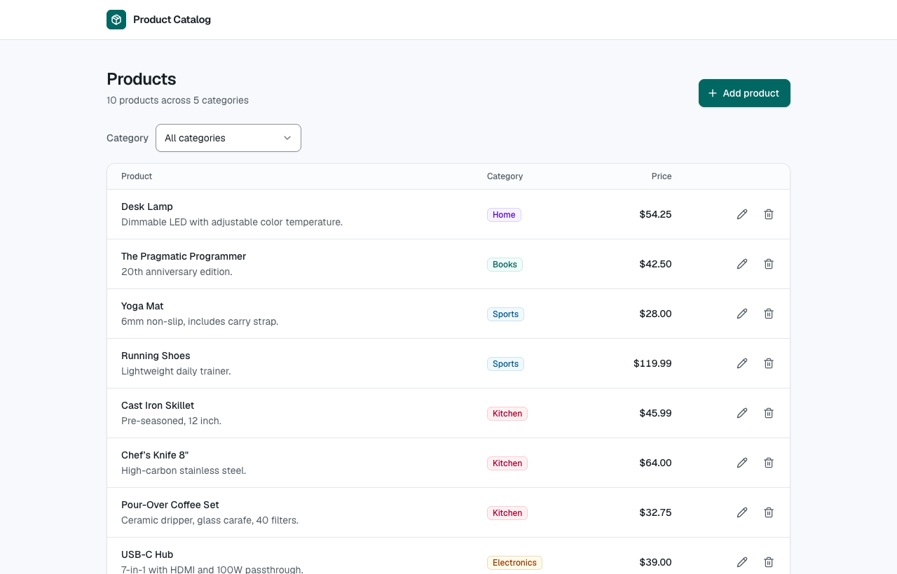
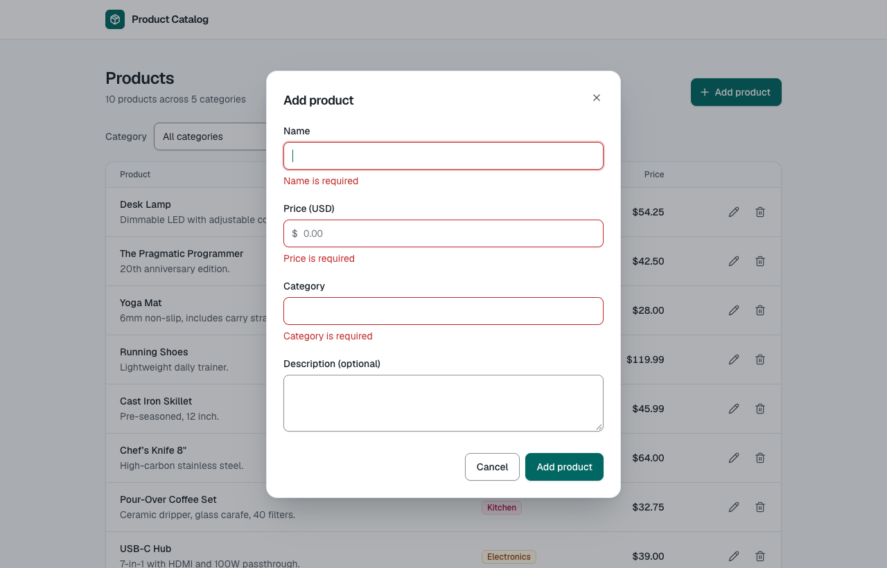
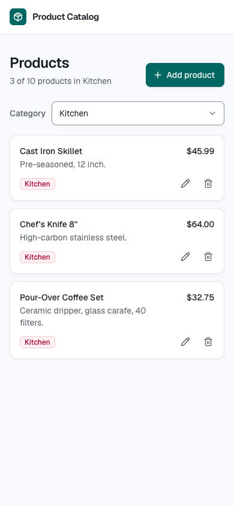

# Product Catalog

A full-stack product catalog for managing products: add, view, filter by category, edit, and delete. It's a React single-page app backed by a Node.js REST API and a SQLite database.



<p>
  
  &nbsp;
  
</p>

## Features

| Requirement | How it works |
|---|---|
| Add a product (name, price, category) | **Add product** opens a dialog with name, price, category (suggests existing categories), and an optional description |
| View a list of products | A table on desktop that becomes cards on phones, newest first, with a summary line ("10 products across 5 categories") |
| Filter by category | A dropdown above the list. The choice is kept in the URL (`?category=Kitchen`), so filtered views can be shared and survive a refresh |
| Edit products | The pencil icon opens the same dialog, prefilled |
| Delete products | The trash icon asks for confirmation before deleting |
| Form validation | Required fields, numeric price, price above 0 and at most 1,000,000, at most 2 decimal places, and length limits. The same rules run on the server |

The app also handles loading, empty, and error states, shows toast confirmations, supports the keyboard (Esc closes dialogs, focus is managed when dialogs open and close), and lays out for phones.

## Tech stack

| Layer | Tools |
|---|---|
| **Frontend** | [React 19](https://react.dev), TypeScript, [Vite 8](https://vite.dev) |
| Styling | [Tailwind CSS v4](https://tailwindcss.com) with design tokens, the [Geist](https://vercel.com/font) font, and [Lucide](https://lucide.dev) icons |
| Data fetching | [TanStack Query](https://tanstack.com/query) |
| Forms | [React Hook Form](https://react-hook-form.com) + [Zod](https://zod.dev) |
| Toasts | [Sonner](https://sonner.emilkowal.ski) |
| **Backend** | [Node.js 24](https://nodejs.org), [Express 5](https://expressjs.com), TypeScript |
| Validation | [Zod](https://zod.dev) |
| **Database** | [SQLite](https://sqlite.org) via [better-sqlite3](https://github.com/WiseLibs/better-sqlite3) |
| **Testing** | [Vitest](https://vitest.dev), [Supertest](https://github.com/ladjs/supertest), [Testing Library](https://testing-library.com), [MSW](https://mswjs.io) |
| **Tooling** | ESLint (backend), oxlint (frontend), GitHub Actions CI |

## Project structure

```
.
├── backend/                     Express REST API
│   ├── src/
│   │   ├── app.ts               createApp(db): middleware, routes, error handling
│   │   ├── server.ts            opens the DB, seeds it, starts listening
│   │   ├── env.ts               PORT, CORS_ORIGIN, DB_PATH, STATIC_DIR
│   │   ├── db/                  SQLite connection, schema, sample data
│   │   ├── products/            zod schema, repository (SQL), router
│   │   └── middleware/          body validation, HttpError, error handler
│   └── test/                    Supertest API tests
├── frontend/                    React app
│   └── src/
│       ├── components/          Button, Dialog, shared form-control styles
│       ├── lib/                 API client, query client, URL param hook, formatting
│       ├── products/            page, list, filter, form, dialogs, hooks, tests
│       └── test/                MSW server, fixtures, render helpers
├── docs/screenshots/
├── Dockerfile                   multi-stage: build UI + API, slim non-root runtime
├── compose.yaml                 run the production image locally
├── compose.dev.yaml             full dev stack in containers with hot reload
└── .github/workflows/
    ├── ci.yml                   lint, typecheck, test, build; Docker build + smoke test
    └── docker-publish.yml       push the image to GHCR from main and version tags
```

## Run with Docker

The quickest way to run everything, with only [Docker](https://docs.docker.com/get-docker/) installed.

```bash
docker compose up --build
```

Open http://localhost:3000. One container serves the UI and the API from the same origin, and the SQLite data is kept in the `catalog-data` volume across restarts. Use `docker compose down -v` to reset the data. Set `APP_PORT=8080` to use a different host port.

**Development in Docker (hot reload):**

```bash
docker compose -f compose.dev.yaml up --build
```

Open http://localhost:5173. Edits to `backend/src` restart the API and edits to `frontend/src` hot-reload the UI. `node_modules` lives in container volumes, so native modules are built for Linux, and nothing has to be installed on the host.

**Deploying the image.** The image is a standard, environment-configured container, so it runs on any container platform (Render, Fly.io, Railway, Cloud Run, ECS, Kubernetes):

```bash
docker build -t product-catalog .
docker run -d -p 3000:3000 -v catalog-data:/data product-catalog
```

- **Configuration:** listens on `PORT` (default 3000). Data goes to `DB_PATH` (default `/data/catalog.db`); mount a volume at `/data` to keep it.
- **Health check:** `GET /api/health`, also built into the image as a `HEALTHCHECK`.
- **Runs as** the non-root `node` user, and shuts down cleanly on `SIGTERM`: it finishes in-flight requests and closes the database.
- **Published images:** after a merge to `main` (or a `v*` tag), CI publishes `ghcr.io/rmdelossantos/co-silver-panda` for amd64 and arm64.
- **Scaling:** SQLite is a single file, so run **one** replica with a persistent volume. To scale out, move the repository layer to Postgres (see Design decisions).

## Run locally

**Prerequisite:** Node.js 24 or newer (`.nvmrc` is provided, so you can run `nvm use`).

### 1. Backend (API on http://localhost:3000)

```bash
cd backend
npm install
npm run dev
```

On first start it creates `backend/data/catalog.db` and seeds 10 sample products. To start over with fresh data, delete the `backend/data/` folder.

### 2. Frontend (app on http://localhost:5173)

In a second terminal:

```bash
cd frontend
npm install
npm run dev
```

Open http://localhost:5173. The Vite dev server forwards `/api/*` requests to the backend on port 3000, so no extra configuration is needed.

### Environment variables (backend, all optional)

| Variable | Default | Purpose |
|---|---|---|
| `PORT` | `3000` | API port |
| `CORS_ORIGIN` | `http://localhost:5173` | Origin allowed to call the API from a browser |
| `DB_PATH` | `data/catalog.db` | SQLite file location (`:memory:` for a throwaway DB). The Docker image uses `/data/catalog.db` |
| `STATIC_DIR` | unset | Directory of the built frontend to serve with the API (set to `/app/public` in the Docker image) |

See `backend/.env.example`. If you change `PORT`, also update the proxy target in `frontend/vite.config.ts`.

### Production build

```bash
cd backend && npm run build && npm start      # compiled API from dist/
cd frontend && npm run build && npm run preview
```

## API

Base URL: `http://localhost:3000/api`

| Method | Path | Body | Success | Errors |
|---|---|---|---|---|
| `GET` | `/health` | | `200 {"status":"ok"}` | |
| `GET` | `/products?category=` | | `200 Product[]`, newest first. `category` is optional and case-insensitive | |
| `GET` | `/products/categories` | | `200 string[]`, distinct and sorted | |
| `GET` | `/products/:id` | | `200 Product` | `400` invalid id, `404` |
| `POST` | `/products` | `ProductInput` | `201 Product` | `400` validation |
| `PUT` | `/products/:id` | `ProductInput` | `200 Product` | `400`, `404` |
| `DELETE` | `/products/:id` | | `204` | `404` |

```ts
// ProductInput
{ name: string; price: number; category: string; description?: string }

// Product
{ id: number; name: string; price: number; category: string; description: string;
  createdAt: string; updatedAt: string }   // ISO 8601 timestamps

// Error
{ error: { message: string; details?: { field: string; message: string }[] } }
```

```bash
curl -X POST localhost:3000/api/products \
  -H 'content-type: application/json' \
  -d '{"name":"Desk Mat","price":19.99,"category":"Home"}'
```

## Testing

```bash
cd backend && npm test     # 35 API tests: every endpoint, validation rule, and error path
cd frontend && npm test    # 47 tests: API client, hooks, filtering, form validation, CRUD flows
```

Each package also has `npm run lint` and `npm run typecheck`. CI runs lint, typecheck, test, and build for both packages on every pull request.

Frontend tests render the real page and hooks against [MSW](https://mswjs.io) request handlers, so they exercise the full flow (fill the form, submit, see the list update) without a running server.

## Design decisions

- **React instead of AngularJS.** The brief prefers AngularJS but allows React. AngularJS 1.x has been end-of-life since 2022, so this uses a current React stack.
- **SQLite.** It's a real SQL database that needs no setup: `npm install` and you're running. The SQL lives only in `products.repo.ts`, so moving to Postgres would touch one file.
- **Prices are stored as integer cents** (`price_cents`) and returned as decimals, which avoids floating-point drift.
- **Validation runs on both sides with the same rules:** zod on the server (the source of truth, backed by `CHECK` constraints) and zod in the form for instant feedback. Server field errors still show on the matching inputs.
- **The price input is text, not `type="number"`.** Browsers blank out invalid number inputs, which would turn "abc" into a misleading "Price is required". With a text input the message can say "Price must be a number", and phones still show a decimal keypad.
- **Filtering happens on the client.** The list is already cached, so changing the filter is instant. The API's `?category=` filter is still available.
- **Server state lives in TanStack Query.** After an add, edit, or delete, the list is fetched again from the server rather than patched locally, so it always matches the database.
- **Dialogs use the native `<dialog>` element,** so focus trapping, Esc to close, and the backdrop come from the browser.

## Development history

The app was built in small pull requests, one concern at a time, each with CI:

1. [#1](https://github.com/rmdelossantos/co-silver-panda/pull/1) Backend scaffold, health endpoint, CI
2. [#2](https://github.com/rmdelossantos/co-silver-panda/pull/2) Products CRUD API with SQLite
3. [#3](https://github.com/rmdelossantos/co-silver-panda/pull/3) Frontend scaffold, API client, test tooling
4. [#4](https://github.com/rmdelossantos/co-silver-panda/pull/4) Product list and category filter
5. [#5](https://github.com/rmdelossantos/co-silver-panda/pull/5) Add and edit form with validation
6. [#6](https://github.com/rmdelossantos/co-silver-panda/pull/6) Delete, list states, toasts
7. [#7](https://github.com/rmdelossantos/co-silver-panda/pull/7) UI polish: design tokens, accessibility, refined states
8. [#8](https://github.com/rmdelossantos/co-silver-panda/pull/8) README
9. [#9](https://github.com/rmdelossantos/co-silver-panda/pull/9) Design critique follow-ups: focus, unsaved edits, long input, copy, stable colors
10. [#10](https://github.com/rmdelossantos/co-silver-panda/pull/10) Docker: production image, Compose for local and dev, CI smoke test, GHCR publishing

## Possible improvements

- Deploy the Docker image online for a live demo, on a platform with a persistent volume.
- AI assistance: suggest a category and description from the product name.
- Search by name, sorting, and pagination for larger catalogs.
- A dedicated categories table if categories need their own management.
- Authentication and per-user catalogs.
